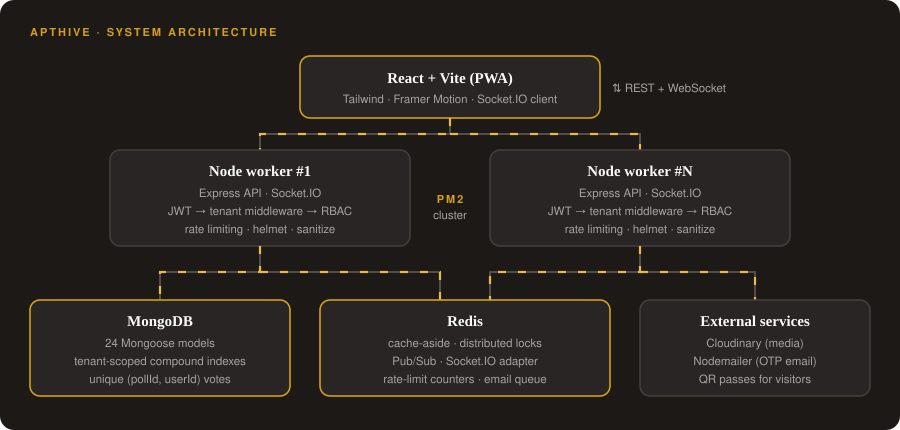

<p align="center">
  
</p>

<p align="center">
  
</p>

<p align="center">
  
  
  
  
  
  
  
  
</p>

---

## 🏢 What is AptHive?

Most apartment societies still run on WhatsApp groups, paper visitor registers and notice boards. **AptHive** replaces all of that with one web platform for residents, the committee, security guards and staff.

It is **multi-tenant**: one deployment serves many societies, and each society's data is strictly isolated. A resident of one society can never see another society's data.

<p align="center">
  
</p>

---

## ✨ Features

<table>
<tr>
<td width="50%" valign="top">

### 🚪 Gate & security
- **Visitor pre-registration** with OTP and QR passes, valid for a set time window
- **Group passes** for parties and events
- **Frequent visitors** and **daily staff** entry logs
- **Delivery management** with resident approval at the gate
- **Security dashboard** for guards to verify passes and log entries

</td>
<td width="50%" valign="top">

### 🏡 Community
- **Amenity booking** with conflict-free slots (gym, pool, clubhouse)
- **Announcements** with a rich-text editor
- **Events** and **polls**, with one vote per resident enforced in the database
- **Maintenance tickets** assigned to staff
- **Lost & found** with photo uploads

</td>
</tr>
<tr>
<td width="50%" valign="top">

### 🚨 Real-time
- **SOS button**: one tap alerts the whole society instantly
- Live **notifications** and delivery requests over Socket.IO
- **Force logout**: a revoked guard is signed out immediately

</td>
<td width="50%" valign="top">

### 🛡️ Administration
- **Society setup** with wings and units
- **Member approvals** and onboarding
- **Role-based access** for 5 roles
- **Guard revocation** with instant sign-out

</td>
</tr>
</table>

---

## 👥 Roles

| Role | Who | What they can do |
|---|---|---|
| 🏠 **Resident** | Flat owner or tenant | Book amenities, pre-register visitors, raise tickets, vote in polls, trigger SOS |
| 🧑‍💼 **Committee** | Society management | Post announcements and events, approve bookings and members, manage tickets |
| 🧹 **Staff** | Maintenance and housekeeping | Pick up and resolve assigned tickets |
| 💂 **Security** | Gate guards | Verify visitor OTPs, log entries and deliveries, respond to SOS |
| 👑 **Super admin** | Platform operator | Create and manage societies on the platform |

Permissions are defined in one place ([`backend/src/config/roles.js`](backend/src/config/roles.js)), so routes, controllers and the UI never drift out of sync.

---

## ⚙️ Engineering highlights

<details open>
<summary><b>🔐 Multi-tenancy</b></summary>

- Every request passes through **JWT auth → tenant middleware → membership guard → RBAC**
- `tenantId` is carried in the token and attached to every query, so data never leaks between societies
- Tenant-scoped **compound indexes** throughout, e.g. `(tenantId, email)` is unique so the same email can join different societies

</details>

<details>
<summary><b>🔒 Race-free booking and voting</b></summary>

- Amenity bookings check for overlapping time ranges (`start < otherEnd && end > otherStart`) inside a **Redis distributed lock** keyed on the amenity
- A **compound unique index** acts as the final safety net at the database layer
- Poll votes use a unique `(pollId, userId)` index, so double votes are impossible even under concurrent requests

</details>

<details>
<summary><b>⚡ Scaling with PM2 and Redis</b></summary>

- Runs in **PM2 cluster mode** (one worker per CPU core) via [`ecosystem.config.cjs`](backend/ecosystem.config.cjs)
- The **Socket.IO Redis adapter** lets an SOS raised on worker 1 reach users connected to worker N
- **Redis rate limiting** (fixed-window `INCR` + TTL) keeps counters shared across all workers
- **Cache-aside** with invalidate-on-write for read-heavy data like amenities and events
- A **Redis-backed email queue** sends OTP emails in the background so API responses stay fast

</details>

<details>
<summary><b>📸 Media and security hardening</b></summary>

- Uploads stream from Multer memory buffers to **Cloudinary**; only URLs are stored in MongoDB
- `helmet`, `compression`, `sanitize-html` and DOMPurify guard against common web attacks
- Structured logging with **Winston**, plus response-time tracking middleware

</details>

---

## 🗂️ Project structure

```
apthive/
├── backend/                 # Express API + Socket.IO
│   ├── src/
│   │   ├── config/          # db, redis, cache, roles, socket events
│   │   ├── middlewares/     # auth, tenant, membership, rate limit
│   │   ├── models/          # 24 Mongoose models
│   │   ├── controllers/     # business logic per module
│   │   ├── routes/          # REST endpoints
│   │   ├── services/        # realtime bus, Redis features, email queue
│   │   └── sockets/         # Socket.IO rooms and handlers
│   └── ecosystem.config.cjs # PM2 cluster config
├── frontend/                # React + Vite + Tailwind (PWA)
│   └── src/
│       ├── pages/           # Dashboard, Visitors, Amenities, Polls, ...
│       ├── components/      # SOS button, notification bell, booking form, ...
│       └── layout/
└── docs/                    # Architecture and feature documentation
```

---

<p align="center">
  Built by <a href="https://github.com/SATTURAMBOWORK"><b>Satvik Singh</b></a>
</p>

<p align="center">
  
</p>
